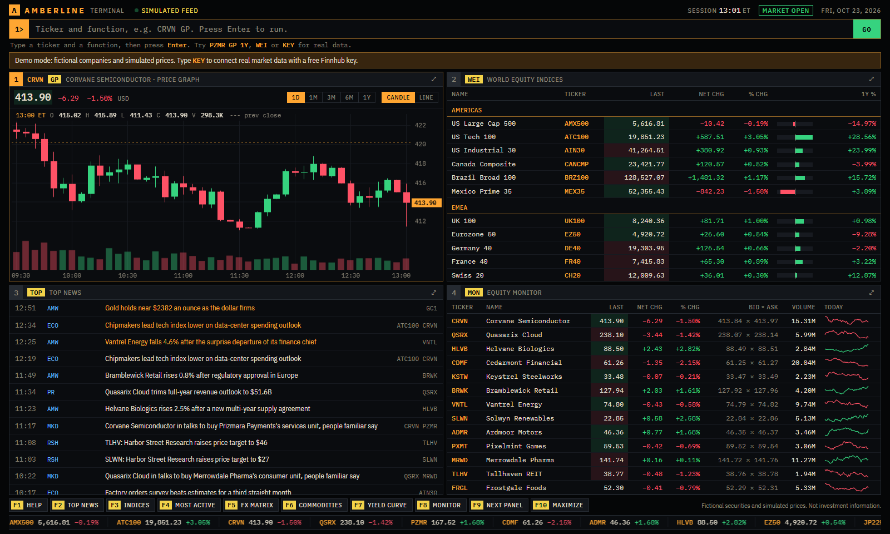

# Amberline Terminal

A professional-style market terminal that runs in your browser. It has a command line with autocomplete, four independent panels, candlestick charts, company profiles, news, function keys and a scrolling ticker tape.

- **Live mode:** real US stocks, ETFs and market news from [Finnhub](https://finnhub.io), using your own free API key, for your own use.
- **Demo mode:** a fictional market that runs with no key and no network. Use it whenever you show the terminal to other people.

There's no build step, no server and no dependencies.



> Amberline is an independent project. It is not affiliated with or endorsed by Bloomberg L.P., Finnhub or any exchange, and contains none of their code. Its function codes follow conventions widely documented for professional terminals, including Bloomberg's. S&P 500, Nasdaq-100, Dow Jones, Russell 2000 and Bloomberg are trademarks of their owners and are used only to describe what each ETF tracks or where a convention comes from. Market data may be delayed or incomplete. Nothing here is investment advice.

## Try it

- **Hosted:** after you enable GitHub Pages (see [Deploy](#deploy)), the terminal is at `https://<your-username>.github.io/amberline-terminal/`
- **Locally:** serve the folder and open <http://localhost:8000>:

```bash
python -m http.server 8000 --bind 127.0.0.1
```

It opens in demo mode. To switch to real data:

1. Get a free key at [finnhub.io/register](https://finnhub.io/register).
2. In the terminal, type `KEY` and press Enter.
3. Paste the key and select **Save and connect**.

Your key is stored in your browser's local storage and is sent only to Finnhub. Other pages served from the same address (for example, your other GitHub Pages projects under `<you>.github.io`) can read it, so use a dedicated domain if that matters to you. To go back to the demo, open `KEY` and select **Remove key and use demo**.

## How to use it

Type a **ticker**, a **function**, or both, then press **Enter**. A ticker on its own opens its description. A function on its own reuses the ticker already in the panel. Add `P1` to `P4` to send the result to a specific panel. In live mode any US stock or ETF ticker works, and autocomplete searches Finnhub as you type.

| Command | Live mode | Demo mode |
| --- | --- | --- |
| `AAPL GP 6M` | Price graph: candles or line, volume, 20/50-day moving averages. `1D`, `1M`, `3M`, `6M`, `1Y`. | Same, for fictional tickers such as `CRVN` |
| `MSFT DES` | Profile, market cap, P/E, EPS, dividend yield, beta, 52-week range, peers | Fictional profile |
| `NVDA NEWS` | Company headlines from the last 7 days | Simulated headlines |
| `TOP` | Market headlines. Select one for the summary and a link to the publisher. | Simulated headlines |
| `WEI` | World markets through country and benchmark ETFs (SPY, QQQ, EWJ…) | Fictional indices |
| `MOST` | Biggest gainers and losers among 20 large caps | Most active, gainers, losers |
| `FXC` | Currency ETFs (FXE, FXY, UUP…) | Cross-rate matrix |
| `CMDTY` | Commodity ETFs (USO, GLD, CORN…) | Simulated futures with quote units |
| `CRV` | Treasury ETFs by maturity, from T-bills to 20+ years | Simulated yield curve |
| `MON` | 20 large caps with day range, intraday line and quote age | Every fictional equity |
| `KEY` | Connection status, request budget, change or remove your key | Add a key |
| `HELP` | Every function, with examples and keyboard shortcuts | Same |

### Keyboard

| Key | Action |
| --- | --- |
| `F1`–`F8` | Load HELP, TOP, WEI, MOST, FXC, CMDTY, CRV or MON into the active panel |
| `F9` | Move to the next panel |
| `F10` | Maximize or restore the active panel (or double-click a panel header) |
| `Alt`+`1`–`4` | Select a panel |
| `Tab` | Accept the highlighted autocomplete suggestion |
| `↑` / `↓` | Command history |
| `Esc` | Clear the command line |
| Any letter | Starts typing a command from anywhere on the page |

## What the free Finnhub plan covers

As understood in October 2026. Check [finnhub.io/pricing](https://finnhub.io/pricing) for the current plans.

| Data | Free plan | How Amberline handles it |
| --- | --- | --- |
| Real-time US stock and ETF quotes | Yes | Streamed over WebSocket during market hours, refreshed by REST about once a minute |
| Company profiles, metrics, peers | Yes | `DES` |
| Company and market news | Yes | `NEWS`, `TOP` |
| Historical candles | Usually not (paid add-on) | `GP` tries candles first. If your plan doesn't include them, it charts live trades since you opened the page and says so. |
| Index levels, futures, spot FX, Treasury yields | No | `WEI`, `CMDTY`, `FXC` and `CRV` use US-listed ETFs as stand-ins and label them that way |
| 60 API calls a minute | Limit | A request queue sends at most 50 calls a minute and fetches the active panel first |

Finnhub's terms limit its plans to personal use and forbid sharing its data, or results derived from it, with anyone without Finnhub's written approval ([terms](https://finnhub.io/terms-of-service)). **Use demo mode for presentations, screenshots and recordings.** Live mode is for your own screen.

## How it works

```
index.html              page shell: top bar, command line, panel grid, function keys, tape
src/finnhub.js          Finnhub client: rate-limited queue, cache, error types, WebSocket stream
src/market.js           one market interface with two implementations: live (Finnhub) and demo
src/data.js             the demo market: fictional instruments, seeded random walk, headlines
src/terminal.js         front end: command parser, autocomplete, panels, canvas charts
src/terminal.css        the look: dark trading-screen palette, IBM Plex type
tests/market.test.js    session-boundary tests for the live market (node tests/market.test.js)
tools/mock_finnhub.py   a local stand-in for the Finnhub API, for development and tests
docs/TEARDOWN.md        the design study behind the interface
```

**The market** (`src/market.js`) is the only thing panels talk to. It exposes instruments, `bars()`, `profile()`, `news()`, `find()` and a once-a-second tick. When a key is saved it builds the live market on top of the Finnhub client. Otherwise it wraps the demo simulator. Panels tell the market which symbols are on screen, so those get streamed and refreshed first.

**The Finnhub client** (`src/finnhub.js`) queues requests by priority and keeps them under the per-minute limit. It shares one request between callers asking for the same thing, caches results for a short time, and turns HTTP errors into clear kinds (`auth`, `premium`, `rate`, `network`). A request that hits the rate limit is retried once, 5 seconds later.

**The front end** (`src/terminal.js`). Each function (`GP`, `DES`, `WEI` and the rest) is a small module with a `mount` method that builds the panel and a `tick` method that updates only the cells that changed. Charts are drawn on `<canvas>`. News text from the API is always inserted as text, never as HTML, and only `http(s)` links are shown.

## Develop without a key

`tools/mock_finnhub.py` answers the same endpoints with made-up data:

```bash
python tools/mock_finnhub.py
```

Then open `http://localhost:8000/?api=http://localhost:8766/api/v1&ws=off` and save any key in `KEY`. Add `--candles` to act like a paid plan that includes historical candles. The key `bad` is rejected so you can test that path. The `api` and `ws` overrides only work when both the page and the endpoint are on `localhost`, so a crafted link can't send someone's key elsewhere.

## Deploy

The repo includes a GitHub Actions workflow (`.github/workflows/pages.yml`) that publishes the site to GitHub Pages on every push to `main`.

1. Push the repo to GitHub.
2. Open **Settings → Pages** and set **Source** to **GitHub Actions**.
3. Push again, or run the workflow from the **Actions** tab. The URL appears in the workflow summary.

The workflow publishes only `index.html`, `src/`, `LICENSE` and `.nojekyll`. Any static host works too. Embedded previews that block outside network requests can only run demo mode.

## License

[MIT](LICENSE). IBM Plex is loaded from Google Fonts under the SIL Open Font License. Market data belongs to Finnhub and its sources and is not covered by this license.
